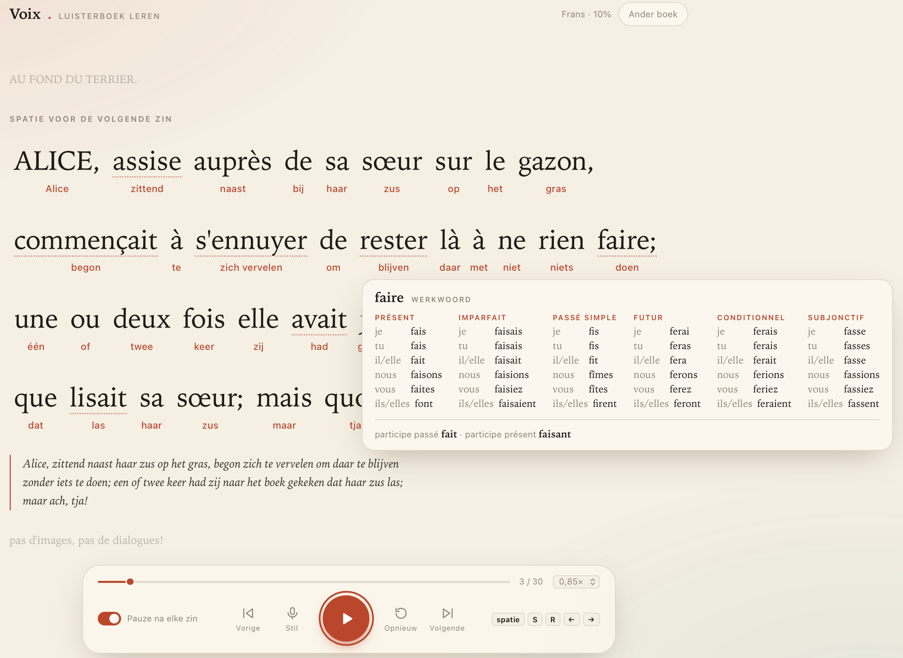

# Voix — luisterboek leren

Webapp om Frans of Spaans te leren met een voorgelezen boek. Je plakt een tekst, hoort die zin voor zin
voorgelezen, ziet elk woord oplichten en krijgt de Nederlandse betekenis er direct onder.



- Woord-voor-woord highlighting, gelijk met de stem
- Nederlandse betekenis per woord, plus een vertaling van de hele zin
- Per zin pauzeren (standaard aan), stil herhalen (zelf meespreken) of opnieuw beluisteren
- Instelbare leessnelheid (0,6× tot 1,15×), zonder dat de stem hoger of lager gaat klinken
- Vervoegingen van werkwoorden bij mouse-over
- Caching per zin: elke zin wordt maar één keer opgehaald en betaald, herlezen is gratis (zie [Caching](#caching))

## Wat je nodig hebt

- Node.js 22.9 of nieuwer
- Een API-sleutel van [ElevenLabs](https://elevenlabs.io) (stem en tijdstempels per woord)
- Een API-sleutel van [Anthropic](https://console.anthropic.com) (vertaling, met Claude Haiku)

## Installeren

```bash
git clone git@github.com:beamzer/audiobook-language-learn.git
cd audiobook-language-learn
npm install
cp .env.example .env
```

Vul daarna je twee sleutels in `.env` in en start de server:

```bash
npm start
```

Open http://localhost:3000.

## Bijwerken

```bash
git pull
npm install
```

Herstart daarna de server.

## Op een webserver

De server luistert alleen op `127.0.0.1` en heeft **geen inlog**. Zet er een reverse proxy met
toegangsbeveiliging voor. Zonder beveiliging kan iedereen die het adres kent audio en vertalingen
laten genereren op kosten van jouw API-sleutels.

De poort stel je in met `PORT` in `.env`.

### Apache als voorkant (met wachtwoord en https)

Gebruik een eigen subdomein, bijvoorbeeld `voix.jouwdomein.nl`: de pagina gebruikt absolute paden
(`/api/...`, `/audio/...`), dus onder een subpad werkt het niet. De commando's gelden voor Debian/Ubuntu.

1. Modules en wachtwoordbestand:

   ```bash
   sudo a2enmod proxy proxy_http ssl headers
   sudo htpasswd -c /etc/apache2/voix.htpasswd jouwnaam
   ```

2. Virtual host. Begin met een gewone http-host op poort 80; certbot maakt daar zelf de https-host
   van (met de certificaatregels) en neemt de rest over. Zet je meteen SSL-regels met nog niet
   bestaande certificaatbestanden in de config, dan start Apache niet en lukt certbot niet.

   ```apache
   <VirtualHost *:80>
       ServerName voix.jouwdomein.nl

       <Location />
           AuthType Basic
           AuthName "Voix"
           AuthUserFile /etc/apache2/voix.htpasswd
           Require valid-user
       </Location>

       ProxyPreserveHost On
       ProxyTimeout 120
       ProxyPass        / http://127.0.0.1:3000/
       ProxyPassReverse / http://127.0.0.1:3000/
   </VirtualHost>
   ```

   `ProxyTimeout 120` is nodig omdat een zin die voor het eerst wordt opgehaald (ElevenLabs en Claude)
   enkele seconden kan duren.

   Laad de config en vraag het certificaat aan. Kies bij de vraag over doorsturen voor een redirect
   naar https; https is verplicht, anders gaat het wachtwoord leesbaar over het internet. Het domein
   moet dan al naar de server wijzen en poort 80 moet bereikbaar zijn.

   ```bash
   sudo apache2ctl configtest && sudo systemctl reload apache2
   sudo certbot --apache -d voix.jouwdomein.nl
   ```

3. De app laten draaien met systemd, in `/etc/systemd/system/voix.service`:

   ```ini
   [Unit]
   Description=Voix
   After=network.target

   [Service]
   WorkingDirectory=/pad/naar/audiobook-language-learn
   ExecStart=/usr/bin/node --env-file-if-exists=.env server.js
   Restart=on-failure
   User=jouwgebruiker

   [Install]
   WantedBy=multi-user.target
   ```

   Controleer met `which node` of het pad klopt en of het Node 22.9 of nieuwer is. Starten:

   ```bash
   sudo systemctl enable --now voix
   ```

   Na een `git pull` herstart je met `sudo systemctl restart voix`.

## Hoe het werkt

| Onderdeel | Bron |
| --- | --- |
| Audio en tijdstempels per woord | ElevenLabs text-to-speech (`with-timestamps`) |
| Vertaling per woord en herkenning van werkwoorden | Claude Haiku 5.5 |
| Franse vervoegingen | Databestand [french-verbs-lefff](https://www.npmjs.com/package/french-verbs-lefff) |
| Spaanse vervoegingen | Regelgebaseerd, via [spanish-verbs](https://www.npmjs.com/package/spanish-verbs) |

Er kan één boek tegelijk geladen zijn; een nieuw boek vervangt het vorige. Het geladen boek staat in
`data/book.json`.

## Caching

De app bewaart alles wat hij per zin ophaalt in de map `cache/`: de audio, de woordtijden, de Nederlandse
vertaling en de herkende werkwoorden. Een zin wordt dus **maar één keer opgehaald en betaald**; daarna
komt hij van schijf.

Waarom dat een voordeel is:

- **Goedkoop:** ElevenLabs rekent per teken en Claude per token. Een boek dat je een tweede of derde keer
  leest, of een zin die je tien keer herhaalt, kost niets extra.
- **Snel:** een zin uit de cache is er direct. Een nieuwe zin kost enkele seconden; de app haalt daarom
  alvast de volgende zin op terwijl je luistert.
- **Altijd dezelfde stem en vertaling:** de uitspraak en betekenis blijven bij herhaling gelijk, ook na
  herstarten of verhuizen van de server.
- **Eén zin, één keer:** wordt dezelfde zin door twee mensen of twee boeken tegelijk gevraagd, dan gaat
  er maar één aanvraag naar de dienst.

Hoe de cache werkt:

- Een zin staat in de cache op basis van zijn tekst, de stem (`ELEVENLABS_VOICE_ID`) en het ElevenLabs-model.
  Pas je de tekst van een zin aan of kies je een andere stem, dan wordt alleen dat opnieuw opgehaald.
- Mislukte aanvragen worden niet bewaard en worden de volgende keer opnieuw geprobeerd.
- De vervoegingen bij mouse-over komen uit een bestand en kosten nooit iets.
- Een uur audio is ongeveer 55 MB. De map groeit dus mee met wat je leest; je kunt hem veilig (deels)
  verwijderen, de app haalt wat ontbreekt dan opnieuw op.
- `cache/`, `data/` en `.env` staan niet in git. Op een nieuwe server begin je met een lege cache, tenzij
  je de map `cache/` meekopieert.

## Bestanden

- `server.js` — de server: boek opknippen in zinnen, ElevenLabs, Claude, vervoegingen, cache
- `public/index.html` — de hele pagina (opmaak en script)
